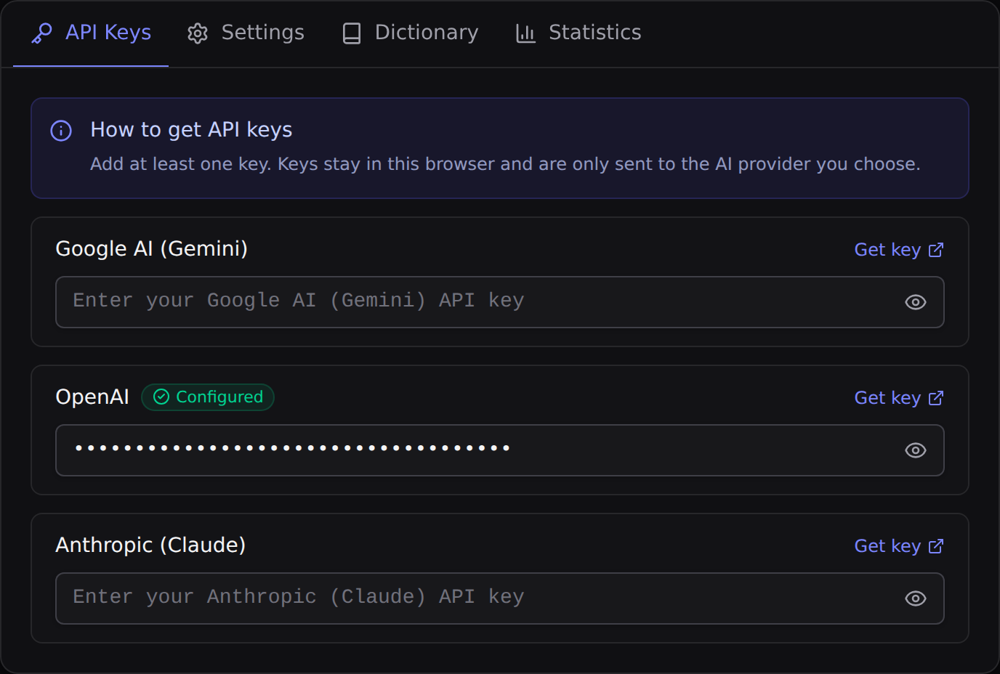
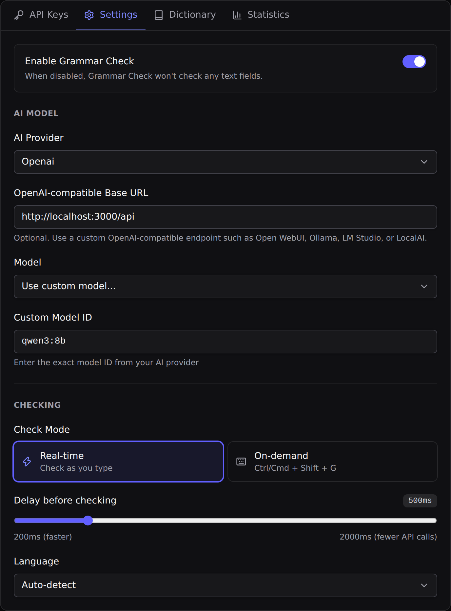
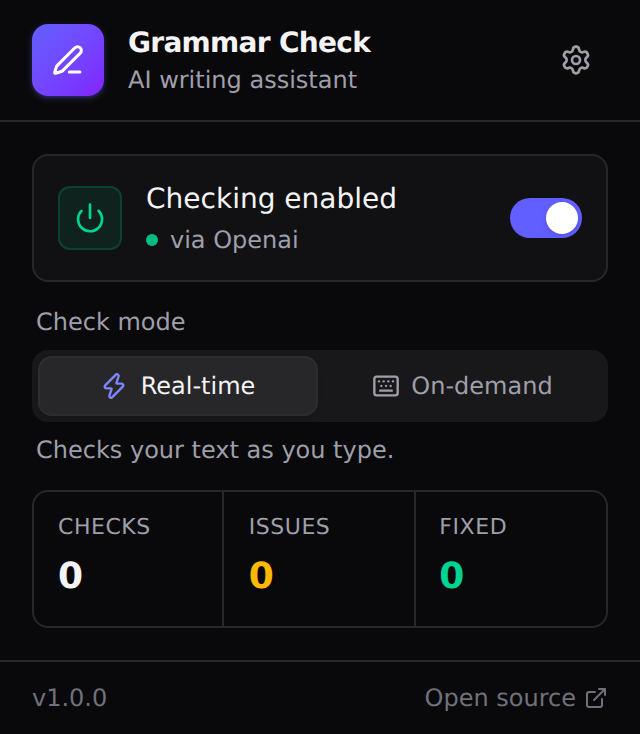

# Grammar Check

**A privacy-first, AI-powered grammar and spelling checker for your browser, with first-class support for local AI models.**

Grammar Check underlines spelling, grammar, punctuation, and style issues as you type, on almost any website. Run it fully offline with a local model through [Ollama](https://ollama.com) or [Open WebUI](https://openwebui.com), or bring your own API key for Google Gemini, OpenAI, Anthropic Claude, or Hugging Face. No account, no subscription, no middleman server.

[](LICENSE)


---

## Table of contents

- [Why Grammar Check?](#why-grammar-check)
- [Features](#features)
- [Privacy and security](#privacy-and-security)
- [Installation](#installation)
- [Quick start: local AI](#quick-start-local-ai)
- [Using a cloud provider](#using-a-cloud-provider)
- [Usage](#usage)
- [Configuration reference](#configuration-reference)
- [Permissions explained](#permissions-explained)
- [Troubleshooting](#troubleshooting)
- [Development](#development)
- [Contributing](#contributing)
- [Security policy](#security-policy)
- [License](#license)

---

## Why Grammar Check?

Most grammar tools send everything you type to their own servers. Grammar Check doesn't have a server at all:

- **Local-first.** Point it at a model running on your own machine and your text never leaves it.
- **Your keys, your provider.** If you prefer a cloud model, your text goes straight from your browser to the provider you choose, using your own API key.
- **Careful about what it reads.** Password, payment, one-time-code, and other sensitive fields are skipped automatically.
- **Free and open source.** MIT licensed. Read the code, audit it, change it.

## Features

- **Real-time checking** as you type, with an adjustable delay
- **On-demand checking** with a keyboard shortcut: <kbd>Ctrl</kbd>+<kbd>Shift</kbd>+<kbd>G</kbd> (<kbd>Cmd</kbd>+<kbd>Shift</kbd>+<kbd>G</kbd> on macOS)
- **Inline underlines**, color-coded by issue type:
  - 🔴 Spelling
  - 🟠 Grammar
  - 🔵 Punctuation
  - 🟣 Style
- **One-click fixes.** Click an underline to apply, ignore, or add the word to your dictionary.
- **Issue panel** listing every suggestion for the current field
, with **Apply all** to fix them in one click
- **Know which AI is reading your text.** The issue panel and rewrite card end with "Checked by Anthropic Claude · claude-haiku-5-5" (or the model and host of your local endpoint, e.g. "qwen3:8b · localhost"), and the toolbar popup shows the active provider and model
- **Rewrite menu.** Select a sentence or paragraph to **Formalize**, make it **Friendly**, **Shorten**, **Proofread**, or **Translate** it, preview the result, and replace the selection in one click
- **Personal dictionary** for names, jargon, and words you use on purpose
- **Multiple AI providers:**
  - Local and self-hosted models through any OpenAI-compatible endpoint (Ollama, Open WebUI, and others)
  - Google Gemini
  - OpenAI
  - Anthropic Claude
  - Hugging Face (open models such as gpt-oss, Llama, Qwen, and DeepSeek through [Inference Providers](https://huggingface.co/docs/inference-providers); needs Hugging Face credits)
- **Custom model IDs** for any model your provider offers
- **12 language options:** auto-detect, English, German, Spanish, French, Italian, Portuguese, Dutch, Polish, Russian, Japanese, and Chinese
- **Works in** text areas, rich-text editors (`contenteditable`), and plain text inputs, including editors inside iframes (TinyMCE, CKEditor) and inside web components (open Shadow DOM). Google Docs support is experimental.
- **Usage statistics**, stored only in your browser

## Privacy and security

| What | How it's handled |
|---|---|
| **Your text** | Sent **only** to the AI endpoint you configure, and only when a check or a rewrite you picked runs. Selecting text alone sends nothing. With a local model, it never leaves your machine. |
| **API keys** | Stored in the browser's **local** extension storage on this device only. Never synced, never sent anywhere except your chosen provider. |
| **Sensitive fields** | Skipped automatically: passwords, email, phone, URL, and number inputs; payment, one-time-code, login, and address fields; and any field marked `spellcheck="false"` (except Gmail's compose body, which sets it for its own spellchecker) or `data-gramm="false"`. |
| **Custom endpoints** | Must use `https://`. Plain `http://` is allowed only for `localhost`, `127.0.0.1`, and `[::1]`, so keys and text are never sent unencrypted over a network. |
| **Results cache** | Recent results are cached locally to avoid repeat requests. The cache holds at most 100 entries, and entries older than one hour are never reused. |
| **Settings sync** | Your settings, personal dictionary, and statistics sync through your browser account so they follow you between devices. **API keys are never synced.** |
| **Tracking** | None. No analytics, telemetry, or third-party scripts. |

Full details are in the [privacy policy](PRIVACY.md).

> **Tip:** Want to keep a specific field private on a site you build? Add `spellcheck="false"` or `data-gramm="false"` to it and Grammar Check will ignore it.

## Installation

### Chrome Web Store

Coming soon.

### From a release

1. Download the latest Chrome or Firefox zip from the [Releases page](https://github.com/Mangesh-P/grammer-check/releases/latest).
2. Extract it.
3. Load it in your browser:
   - **Chrome, Edge, Brave, Arc:**
     1. Open `chrome://extensions`.
     2. Turn on **Developer mode**.
     3. Click **Load unpacked** and select the extracted folder.
   - **Firefox** (140 or later; 142 or later on Android):
     1. Open `about:debugging#/runtime/this-firefox`.
     2. Click **Load Temporary Add-on** and select the `manifest.json` file in the extracted folder.
     3. Temporary add-ons are removed when Firefox restarts.

### From source

Requires [Node.js](https://nodejs.org) 22 or later.

```bash
git clone https://github.com/Mangesh-P/grammer-check.git
cd grammar-check
npm ci
npm run build            # Chrome  -> .output/chrome-mv3
npm run build:firefox    # Firefox -> .output/firefox-mv2
```

Then load the output folder as described above.

## Quick start: local AI

Running a model locally keeps your writing entirely on your machine. This guide uses **Open WebUI**. Plain Ollama works too; see [below](#using-ollama-directly).

### Recommended local models

| Model | Status | Notes |
|---|---|---|
| `qwen3:8b` | ✅ Recommended | Best balance of accuracy and speed in testing |
| `phi4-mini` | ⚠️ Not recommended | Often misses errors or returns malformed output |
| `gemma3:4b` | ⚠️ Not recommended | Often misses errors or returns malformed output |

Larger models are generally more accurate. Smaller models respond faster.

### 1. Create an Open WebUI API key

In Open WebUI, go to **Settings → Account** and create an API key for this project.

### 2. Configure Grammar Check

1. Click the Grammar Check icon in your toolbar, then the ⚙️ settings button.
2. On the **API Keys** tab, paste your Open WebUI key into the **OpenAI** field.

   

3. On the **Settings** tab:
   - **AI Provider:** `OpenAI`
   - **OpenAI-compatible Base URL:** `http://localhost:3000/api`
   - **Model:** choose **Use custom model...** and enter `qwen3:8b`

   > **Why a localhost URL under "OpenAI"?** Open WebUI and Ollama speak the same API format as OpenAI, so the OpenAI provider can talk to them. This URL points the extension at Open WebUI on your own machine instead of `api.openai.com`, so your text never leaves your computer. Use whatever port your Open WebUI runs on (`3000` is the common Docker setup).

   

4. Start typing in any text box.

### Using Ollama directly

Ollama exposes an OpenAI-compatible API, so the setup is the same:

| Setting | Value |
|---|---|
| AI Provider | `OpenAI` |
| OpenAI-compatible Base URL | `http://localhost:11434/v1` |
| API key (OpenAI field) | Any non-empty value, such as `ollama` |
| Custom model ID | The model name, such as `qwen3:8b` |

By default, Ollama rejects requests from browser extensions. Allow them by setting the `OLLAMA_ORIGINS` environment variable before starting Ollama:

```bash
# Chrome, Edge, Brave
OLLAMA_ORIGINS="chrome-extension://*" ollama serve

# Firefox
OLLAMA_ORIGINS="moz-extension://*" ollama serve
```

Any other OpenAI-compatible server, such as LM Studio or LocalAI, should work the same way. Enter its base URL and model name.

## Using a cloud provider

1. Get an API key:
   - [Google AI Studio](https://aistudio.google.com/apikey) (Gemini)
   - [OpenAI Platform](https://platform.openai.com/api-keys)
   - [Anthropic Console](https://console.anthropic.com/settings/keys) (Claude)
   - [Hugging Face access tokens](https://huggingface.co/settings/tokens): create a fine-grained token with the **Make calls to Inference Providers** permission
2. Paste it on the **API Keys** tab.
3. On the **Settings** tab, pick the provider and a model, or enter a custom model ID.

With Hugging Face, the custom model ID is any chat model's repo ID from huggingface.co (for example `Qwen/Qwen3-8B`) that is served by an Inference Provider. Hugging Face only uses the providers enabled in your [Inference Providers settings](https://huggingface.co/settings/inference-providers); if you see "not supported by any provider you have enabled", enable more providers there or pick another model. Requests go to `router.huggingface.co`, which forwards them to the provider serving that model.

> **Hugging Face is a paid option.** The models are open, but running them on Hugging Face's servers costs credits. Free accounts get only a very small monthly allowance, which real-time checking uses up within a few requests. To use Hugging Face regularly you need [pre-paid credits or a PRO subscription](https://huggingface.co/settings/billing). To run the same open models (gpt-oss, Llama, Qwen) for free, use [Ollama on your own computer](#quick-start-local-ai) instead.

Cloud providers charge for API usage according to their own pricing. Real-time mode sends a request after each pause in typing. Use **On-demand** mode or a longer delay to cut costs.

## Usage

1. **Type** in a text box. In real-time mode, a status button appears next to the field:
   - **Spinner + "Grammar Check":** the AI provider is checking your text
   - **Red count:** issues found
   - **Green check:** no issues
   - **Amber "Grammar Check failed":** the check didn't complete; hover it to see why (for example, a missing API key or an unreachable endpoint)

   Hover any state for a tooltip that starts with "Grammar Check", so you can tell it apart from other writing tools on the page.
2. **Click an underline** to see the suggestion and explanation, then choose:
   - **Apply** to fix it
   - **Ignore** to dismiss it
   - **+Dict** to add a spelling to your personal dictionary
3. **Click the status button** to open the panel with every issue in the field.
 Use **Apply all** in its header to fix them all at once.
4. **Press** <kbd>Ctrl</kbd>+<kbd>Shift</kbd>+<kbd>G</kbd> (<kbd>Cmd</kbd>+<kbd>Shift</kbd>+<kbd>G</kbd> on macOS) to run a check on demand.
5. **Select three or more words** to rewrite them. A small **✨ Grammar Check** button appears above the selection; click it and choose:
   - **Formalize** for a more professional tone
   - **Friendly** for a warmer, conversational tone
   - **Shorten** to make it more concise
   - **Proofread** to fix only spelling, grammar and punctuation, keeping your wording (if nothing needs fixing, the card says so)
   - **Translate ›** and pick a language. The last language you used is listed first.

   A preview card shows the result. Click **Replace** to swap it in (<kbd>Ctrl</kbd>+<kbd>Z</kbd> undoes it), **Copy** to copy it, or **Try again** for another version. Press <kbd>Esc</kbd> or click elsewhere to close. Turn the button off with **Rewrite menu** in the settings.

Use the toolbar popup to turn Grammar Check on or off, switch between real-time and on-demand modes, and see your stats.



To change the shortcut, open `chrome://extensions/shortcuts` in Chrome, or **Manage Extension Shortcuts** in Firefox's add-ons page.

## Configuration reference

All settings are on the extension's options page.

| Setting | Options | Default |
|---|---|---|
| AI Provider | Google, OpenAI (or OpenAI-compatible), Anthropic, Hugging Face | Google |
| Model | Built-in list per provider, or a custom model ID | `gemini-3.8-flash` |
| OpenAI-compatible Base URL | Empty for OpenAI, or an OpenAI-compatible endpoint | Empty |
| Check Mode | Real-time or On-demand | Real-time |
| Delay before checking | 200 to 2000 ms | 500 ms |
| Language | Auto-detect or one of 11 languages | Auto-detect |
| Enabled | On or off | On |
| Rewrite menu | On or off | On |
| Translate to | Any supported language except Auto-detect, plus Hindi and Marathi; the language listed first under **Translate** | English |

## Permissions explained

| Permission | Why it's needed |
|---|---|
| `storage` | Saves your settings, dictionary, statistics, and API keys in the browser |
| `activeTab` | Lets the keyboard shortcut trigger a check on the current tab |
| Access to all websites | Lets Grammar Check show underlines in text fields on any site, and send requests to the AI endpoint you configure, including a custom local or self-hosted one |

Grammar Check only reads text from the editable field you're typing in. It doesn't read page content, browsing history, or cookies.

## Troubleshooting

| Problem | Solution |
|---|---|
| "No API key configured" | Add a key for the selected provider on the **API Keys** tab. Local servers like Ollama accept any non-empty value. |
| "Your Hugging Face credits are used up" | Add pre-paid credits or subscribe to PRO at [huggingface.co/settings/billing](https://huggingface.co/settings/billing), or switch to a local model through Ollama, which is free. |
| "Not supported by any provider you have enabled" (Hugging Face) | Pick another model, or enable more providers in your [Inference Providers settings](https://huggingface.co/settings/inference-providers). |
| "OpenAI base URL must use https://" | Use an `https://` URL. For a server on another machine on your network, put it behind HTTPS, for example with a reverse proxy. |
| Ollama returns a 403 error | Set `OLLAMA_ORIGINS` as shown in [Using Ollama directly](#using-ollama-directly). |
| No underlines on a field | The field may be skipped on purpose (see [Privacy and security](#privacy-and-security)). Also check that the extension is enabled in the popup and that the text is at least a few words long. |
| Suggestions are poor or missing | Try a larger model. Small local models often struggle with structured output. |
| Nothing happens in on-demand mode | Click into the text field first, then press the shortcut. Check that the shortcut isn't taken by another extension. |

## Development

```bash
npm ci                   # install dependencies
npm run dev              # Chrome, with hot reload
npm run dev:firefox      # Firefox, with hot reload
npm run build            # production build for Chrome
npm run build:firefox    # production build for Firefox
npm run zip              # packaged zip for Chrome
npm run zip:firefox      # packaged zip for Firefox
npx tsc --noEmit         # type-check
npm run lint             # lint with Biome
npm test                 # unit and integration tests (Vitest)
```

### Tech stack

- [WXT](https://wxt.dev): browser extension framework
- [React](https://react.dev) and [Tailwind CSS](https://tailwindcss.com): popup and options UI
- [Vercel AI SDK](https://ai-sdk.dev): multi-provider AI integration
- [TypeScript](https://www.typescriptlang.org)

### Project structure

```text
src/
├── entrypoints/
│   ├── background.ts       # Message handling, AI calls, caching
│   ├── content/            # Content script: field detection, underlines, popovers, rewrite menu
│   ├── popup/              # Toolbar popup (React)
│   └── options/            # Settings page (React)
├── lib/
│   ├── ai/
│   │   ├── grammar-check.ts    # Grammar check and response parsing
│   │   ├── providers.ts        # Provider setup and endpoint validation
│   │   ├── prompts.ts          # Prompt builders
│   │   └── prompts/            # System prompts as Markdown
│   ├── selection.ts        # Selected-text helpers for the rewrite menu
│   ├── storage.ts          # Settings, keys, dictionary, cache
│   └── utils.ts            # DOM helpers and sensitive-field detection
└── types/                  # Shared types, defaults, model list
```

### Customizing prompts

The system prompts are plain Markdown files in `src/lib/ai/prompts/`:

- `grammar.md` controls how issues are detected and the JSON format the model must return.
- `rewrite.md` is the prompt behind the rewrite menu (Formalize, Friendly, Shorten). The per-style instructions are in `createRewritePrompt` in `prompts.ts`.
- `proofread.md` and `translate.md` are the prompts behind the menu's **Proofread** and **Translate** items.

Edit them and rebuild. This is useful for tuning behavior for a specific local model.

## Contributing

Contributions are welcome.

1. Fork the repository and create a feature branch.
2. Make your change, then run `npm run lint`, `npx tsc --noEmit`, `npm test` and `npm run build`.
3. Open a pull request describing what changed and why.

For larger changes, please open an issue first to discuss the approach.

## Security policy

Please **don't** report security vulnerabilities in public issues. Report them privately through [GitHub Security Advisories](https://github.com/Mangesh-P/grammer-check/security/advisories/new). Include steps to reproduce and the potential impact.

## License

[MIT](LICENSE)
